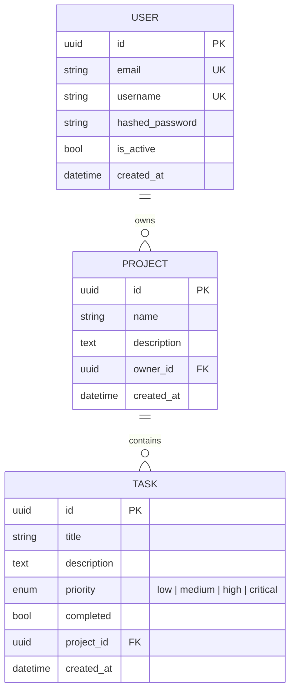

# Nexus — AI-Assisted Project Management

A full-stack project management app where a zero-shot NLP model assigns a
priority to each new task from its title and description. FastAPI,
PostgreSQL, React, Docker, deployed to AWS EC2 through GitHub Actions.

---

## Features

- **Authentication**: registration and login with bcrypt-hashed passwords and JWT bearer tokens
- **Projects and tasks**: each user sees only their own projects; tasks belong to a project and can be edited or completed
- **AI task prioritization**: `facebook/bart-large-mnli` zero-shot classification labels each new task Low / Medium / High / Critical
- **REST API** with Swagger docs at `/docs`
- **Database migrations** with Alembic
- **Tests and CI**: pytest suite against Postgres in GitHub Actions, plus a frontend build check
- **Docker Compose** for the backend and Postgres
- **Deployment workflow** to AWS EC2 on push to `main`
- **Load test** definition in `locustfile.py`

---

## Tech Stack

| Layer | Technology |
|---|---|
| Backend | FastAPI (Python) |
| Database | PostgreSQL, SQLAlchemy, Alembic |
| Authentication | JWT (python-jose) + bcrypt (passlib) |
| NLP | Hugging Face Transformers, `facebook/bart-large-mnli` zero-shot classification |
| Frontend | React + Tailwind CSS + Vite |
| Containerization | Docker + Docker Compose |
| Deployment | AWS EC2 (Ubuntu) via GitHub Actions |
| Testing | pytest, Locust |

---

## Data model



---

## Project Structure

```
nexus/
├── app/
│   ├── main.py               # FastAPI app entrypoint
│   ├── database.py           # SQLAlchemy engine and session
│   ├── models/models.py      # User, Project, Task ORM models
│   ├── routers/
│   │   ├── auth.py           # /auth/register, /auth/login, /auth/me
│   │   ├── projects.py       # project endpoints
│   │   └── tasks.py          # task endpoints + NLP priority scoring
│   └── core/
│       ├── deps.py           # current-user dependency
│       └── security.py       # JWT + bcrypt utilities
├── migrations/               # Alembic migrations
├── tests/                    # pytest suite
├── nexus-frontend/           # React frontend (single-page app)
├── locustfile.py             # load test
├── Dockerfile                # backend image (runs migrations, then uvicorn)
├── docker-compose.yml        # backend + PostgreSQL
├── .env.example              # copy to .env
└── .github/workflows/        # CI, migration checks, EC2 deploy
```

---

## Getting Started

### Prerequisites
- Python 3.11+
- Node.js 20+
- PostgreSQL 16 (or Docker)

### Run locally

```bash
git clone https://github.com/Sanjay180803/Nexus.git
cd Nexus

python -m venv venv
source venv/bin/activate          # Windows: venv\Scripts\activate
pip install -r requirements.txt

cp .env.example .env              # set DATABASE_URL and SECRET_KEY
createdb taskmanager              # or CREATE DATABASE in psql
alembic upgrade head

uvicorn app.main:app --reload
```

In a second terminal:

```bash
cd nexus-frontend
npm install
npm run dev
```

App: http://localhost:5173 · API docs: http://localhost:8000/docs

The first task you create downloads the ~1.6 GB `bart-large-mnli` model.

### Run with Docker

```bash
cp .env.example .env              # set POSTGRES_PASSWORD and SECRET_KEY
docker compose up --build
```

API at http://localhost:8000. The container applies migrations before starting.

---

## Tests

```bash
pip install pytest
pytest tests -v
```

Tests use SQLite by default and Postgres when `DATABASE_URL` points at it.
The NLP model is replaced with a deterministic stub, so tests do not
download it. CI runs the suite against Postgres 16 on every pull request.

---

## API Endpoints

All endpoints except register and login need `Authorization: Bearer <token>`.

### Auth
| Method | Endpoint | Description |
|---|---|---|
| POST | `/auth/register` | Create an account |
| POST | `/auth/login` | Log in and receive a JWT |
| GET | `/auth/me` | Current user's id, email, username |

### Projects
| Method | Endpoint | Description |
|---|---|---|
| POST | `/projects/` | Create a project |
| GET | `/projects/` | List your projects |
| GET | `/projects/{id}` | Get one of your projects |

### Tasks
| Method | Endpoint | Description |
|---|---|---|
| POST | `/tasks/{project_id}/tasks` | Create a task (model assigns priority) |
| GET | `/tasks/{project_id}/tasks` | List tasks in a project |
| PATCH | `/tasks/{project_id}/tasks/{task_id}` | Update title, description, or completion |

---

## AI Priority Scoring

When a task is created, `"{title}. {description}"` is passed to the
`facebook/bart-large-mnli` zero-shot classifier with four candidate labels:
`low priority`, `medium priority`, `high priority`, `critical priority`.
The highest-scoring label becomes the task's priority. There is no keyword
list; the model scores the text against each label.

Example request:
```json
{
  "title": "Server is down",
  "description": "Production database crashed, all users locked out"
}
```

The model is loaded once, on the first task creation, and kept in memory.
Classification runs synchronously on CPU, so task creation is the slowest
endpoint.

Not yet measured: agreement between the model's labels and human-assigned
priorities.

---

## Load testing

`locustfile.py` simulates users who register, create a project, list
projects and tasks, create tasks (which runs the model), and complete them.

```bash
pip install locust
locust -f locustfile.py --host http://localhost:8000 \
       --users 100 --spawn-rate 10 --run-time 2m --headless \
       --csv benchmarks/locust
```

Results are written to `benchmarks/locust_stats.csv`. Record the hardware
and whether the real model or a stub was used alongside any numbers.

---

## Deployment

`.github/workflows/deploy.yml` runs on every push to `main`. It SSHes into
the EC2 host (`EC2_HOST`, `EC2_USER`, `EC2_SSH_KEY` repository secrets),
pulls the latest code, and rebuilds the Docker Compose stack. The server
needs its own `.env` next to `docker-compose.yml`.
